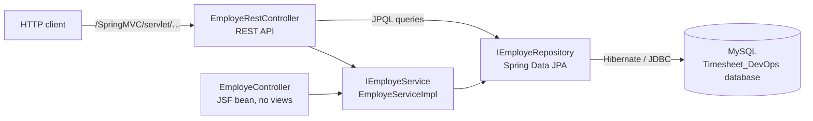

# Timeseet_DevOps — Timesheet DevOps, first iteration (Employee module)

[Français](README.md) · **English**

First iteration of the "Timesheet DevOps" team project (ESPRIT, 2021): a Spring Boot application limited to
the Employee module, with JUnit tests and GitHub Actions continuous integration.

> The complete version of the project (Contract and Mission modules, Jenkins pipeline, Docker image) lives in
> [Timesheet_DevOps](https://github.com/rachedchakchouk/Timesheet_DevOps). The differences between the two
> repositories are described below, in [Relationship with Timesheet_DevOps](#relationship-with-timesheet_devops).

## Overview

- JPA model of a timesheet application: companies, departments, employees, contracts, missions (internal and
  external), timesheets and users.
- Employee service (`IEmployeService` / `EmployeServiceImpl`): create, list, count, delete, and look up by
  email and password.
- Seven-route REST API (`EmployeRestController`).
- JSF bean for login and employee management (`EmployeController`); the repository contains no JSF view.
- Tests: Spring context startup (JUnit 5) and Employee service tests (JUnit 4).

## Tech stack

Versions read from `pom.xml`, `.mvn/wrapper/maven-wrapper.properties` and `.github/workflows/ci.yml`.

| Layer | Technology | Version |
|---|---|---|
| Language | Java | 8 (`java.version` = 1.8) |
| Framework | Spring Boot (Web, Data JPA) | 2.7.18 |
| Framework | Spring Framework | 5.3.39 (pinned in the pom) |
| Embedded server | Apache Tomcat | 9.0.123 (pinned in the pom) |
| Persistence | Hibernate ORM | managed by Spring Boot (5.6.15.Final according to the CI log) |
| Database | MySQL, `com.mysql:mysql-connector-j` driver | driver 8.4.0; MySQL 8.4 in CI |
| JSF (no views) | Apache MyFaces (`myfaces-api`, `myfaces-impl`), OCPsoft Rewrite, `tomcat-embed-jasper` | 2.2.15; 3.5.2.Final; managed by Spring Boot |
| Tooling | Lombok (declared, not used in the code) | managed by Spring Boot |
| Logging | Logback (Spring Boot); Log4j 2 API in the tests | Log4j 2.25.5 (`log4j2.version`) |
| Tests | JUnit 5 (`spring-boot-starter-test`), JUnit 4 with `junit-vintage-engine`, AssertJ | managed by Spring Boot |
| Build | Maven, through the Maven Wrapper | Maven 3.8.2 |
| CI | GitHub Actions, Temurin JDK, MySQL service | JDK 8, `mysql:8.4` image |

## Architecture

Layered architecture: `entity` → `repository` (Spring Data JPA) → `service` → controllers. The REST controller
calls the service and, for JPQL queries, the repository directly.



The session-scoped `EmployeController` bean handles login, restricted to the `ADMINISTRATEUR` role, and adding,
editing and deleting employees. It navigates to `/login.xhtml` and `/pages/admin/welcome.xhtml`, but these views
are not in the repository and no `FacesServlet` is declared: only the REST API is usable.

## Repository layout

```text
Timeseet_DevOps/
├── .github/
│   ├── dependabot.yml              # Maven and GitHub Actions updates
│   └── workflows/ci.yml            # CI: build and tests against MySQL
├── .mvn/wrapper/                   # Maven Wrapper (Maven 3.8.2)
├── mvnw, mvnw.cmd                  # wrapper launchers (Linux/macOS, Windows)
├── pom.xml
└── src/
    ├── main/java/tn/esprit/spring/
    │   ├── TimesheetDevOpsApplication.java
    │   ├── control/                # EmployeController (JSF bean)
    │   ├── entity/                 # JPA entities and the Role enum
    │   ├── repository/             # IEmployeRepository (JPQL queries)
    │   ├── rest/control/           # EmployeRestController (REST API)
    │   └── service/                # IEmployeService, EmployeServiceImpl
    ├── main/resources/application.properties
    └── test/java/tn/esprit/spring/
        ├── TimesheetDevOpsApplicationTests.java    # context startup (JUnit 5)
        └── test/EmployeServiceImplTest.java        # Employee service tests (JUnit 4)
```

## Prerequisites

- JDK 8 (CI uses Temurin 8). On Windows, `JAVA_HOME` must point to this JDK, otherwise `mvnw.cmd` stops.
- MySQL 8 on `localhost:3306`, with the `root` account and no password (the repository's configuration), or
  Docker to start the same MySQL as the CI.
- Git. Maven itself is not needed: the wrapper downloads Maven 3.8.2 (requires access to Maven Central).

## Local setup and run

Windows (PowerShell):

```powershell
git clone https://github.com/rachedchakchouk/Timeseet_DevOps.git
cd Timeseet_DevOps

# Optional: MySQL 8.4 as in CI (root, no password); wait until it is ready
docker run -d --name mysql-timesheet -p 3306:3306 -e MYSQL_ALLOW_EMPTY_PASSWORD=yes mysql:8.4

.\mvnw.cmd spring-boot:run
```

Linux / macOS (`mvnw` is not marked executable in the repository: run it with `sh` or `chmod +x mvnw` first):

```bash
git clone https://github.com/rachedchakchouk/Timeseet_DevOps.git
cd Timeseet_DevOps
docker run -d --name mysql-timesheet -p 3306:3306 -e MYSQL_ALLOW_EMPTY_PASSWORD=yes mysql:8.4   # optional
sh mvnw spring-boot:run
```

The application listens on port **9090**; every route is prefixed with `/SpringMVC/servlet`, for example
<http://localhost:9090/SpringMVC/servlet/count-employe>.

To build and run the executable JAR:

```powershell
.\mvnw.cmd -B package -DskipTests
java -jar target\Timesheet_DevOps-1.0.jar
```

```bash
sh mvnw -B package -DskipTests
java -jar target/Timesheet_DevOps-1.0.jar
```

## Configuration

All the configuration is in `src/main/resources/application.properties`; no Spring profile is defined.

| Key | Value in the repository | Purpose |
|---|---|---|
| `server.port` | `9090` | HTTP port |
| `server.servlet.context-path` | `/SpringMVC` | application path |
| `spring.mvc.servlet.path` | `/servlet` | `DispatcherServlet` path |
| `spring.datasource.url` | `jdbc:mysql://localhost:3306/Timesheet_DevOps?createDatabaseIfNotExist=true&…` | MySQL database, created if missing |
| `spring.datasource.username` | `root` | MySQL account |
| `spring.datasource.password` | empty | MySQL password |
| `spring.jpa.hibernate.ddl-auto` | `update` | schema created or updated at startup |
| `spring.jpa.show-sql` | `true` | SQL statements printed to the console |
| `spring.jpa.properties.hibernate.dialect` | `org.hibernate.dialect.MySQL5Dialect` | SQL dialect |
| `logging.file.name` | `D:/LOG` | log file (Windows path) |
| `logging.logback.rollingpolicy.max-file-size` | `100KB` | maximum size of a log file |
| `logging.level.root` | `INFO` | log level |

Any key can be overridden with an environment variable (Spring Boot convention) without editing the file, for
example for a password-protected MySQL account or another log path:

```powershell
$env:SPRING_DATASOURCE_USERNAME = "<user>"
$env:SPRING_DATASOURCE_PASSWORD = "<password>"
$env:LOGGING_FILE_NAME = "logs/timesheet.log"
.\mvnw.cmd spring-boot:run
```

```bash
export SPRING_DATASOURCE_USERNAME='<user>'
export SPRING_DATASOURCE_PASSWORD='<password>'
export LOGGING_FILE_NAME=logs/timesheet.log
sh mvnw spring-boot:run
```

On Linux and macOS, `D:/LOG` is a relative path: unless overridden, the log is written to `D:/LOG` under the
working directory.

## Database

- Engine: MySQL. The `Timesheet_DevOps` database is created on first startup (`createDatabaseIfNotExist=true`).
- Schema: generated by Hibernate (`ddl-auto=update`); no migration tool (Flyway, Liquibase).
- Tables created (CI log): `t_contrat`, `t_departement`, `t_departement_employe` (join table), `t_employe`,
  `t_entreprise`, `t_mission`, `t_timesheet`, `t_user`.
- The `MySQL5Dialect` dialect creates MyISAM tables: MySQL does not enforce the declared foreign keys on them
  and they have no transaction support.
- No demo data is provided.

Relationships between entities (JPA annotations):

| Relationship | Implementation |
|---|---|
| `Entreprise` 1 — n `Departement` | `entreprise_id` column in `t_departement` |
| `Departement` n — n `Employe` | `t_departement_employe` table |
| `Departement` 1 — n `Mission` | `departement_id` column in `t_mission` |
| `Employe` 1 — 1 `Contrat` | `contrat_reference` column in `t_employe` |
| `Employe` 1 — n `Timesheet`, `Mission` 1 — n `Timesheet` | `employe_id` and `mission_id` columns in `t_timesheet` |
| `MissionExterne` extends `Mission` | single `t_mission` table, `dtype` column |
| `User` | standalone `t_user` table (role stored as its ordinal) |

The `Role` enum is one of `CHEF_DEPARTEMENT`, `INGENIEUR`, `TECHNICIEN`, `STUDENT` or `ADMINISTRATEUR`.

## API

Base URL: `http://localhost:9090/SpringMVC/servlet`. No route is protected.

| Method | Path | Input | Response |
|---|---|---|---|
| POST | `/ajouter-employe` | `Employe` JSON body | ID of the new employee |
| GET | `/count-employe` | — | number of employees (Spring Data `count()`) |
| GET | `/count-employe-jpql` | — | number of employees (JPQL query) |
| GET | `/get-employeprenom-by-id/{idemploye}` | ID | the employee's `nomEmploye` field |
| GET | `/get-all-nameemploye` | — | list of last names (`nomEmploye`) |
| GET | `/get-all-employe-by-entreprise` | `Entreprise` JSON body (GET request with a body) | employees of the company's departments |
| GET | `/get-employe-by-email-password/{email}/{password}` | email and password in the URL | matching employee |

Example (JSON keys follow the accessors of the `Employe` entity):

```bash
curl http://localhost:9090/SpringMVC/servlet/count-employe
curl -X POST http://localhost:9090/SpringMVC/servlet/ajouter-employe \
  -H "Content-Type: application/json" \
  -d '{"nomEmploye":"Test","prenomEmploye":"Exemple","emailEmploye":"exemple@example.com","actif":true,"roleEmploye":"INGENIEUR","password":"changeme"}'
```

```powershell
Invoke-RestMethod http://localhost:9090/SpringMVC/servlet/count-employe
Invoke-RestMethod -Method Post -Uri http://localhost:9090/SpringMVC/servlet/ajouter-employe -ContentType "application/json" -Body '{"nomEmploye":"Test","prenomEmploye":"Exemple","emailEmploye":"exemple@example.com","actif":true,"roleEmploye":"INGENIEUR","password":"changeme"}'
```

## Tests

| Class | Kind | Needs |
|---|---|---|
| `TimesheetDevOpsApplicationTests` | JUnit 5: Spring context startup | a reachable MySQL |
| `EmployeServiceImplTest` | JUnit 4 (`@RunWith(SpringRunner.class)`), run by the vintage engine: add, non-empty list, count, lookup of an employee by email and password, deletion of employee no. 6; timeouts on add and delete | an already populated database (a specific employee, ID 6) |

Tests as the CI runs them (without `EmployeServiceImplTest`):

```powershell
.\mvnw.cmd -B verify "-Dtest=!EmployeServiceImplTest" "-Dsurefire.failIfNoSpecifiedTests=false"
```

```bash
sh mvnw -B verify -Dtest='!EmployeServiceImplTest' -Dsurefire.failIfNoSpecifiedTests=false
```

All tests, against a database holding the expected data: `.\mvnw.cmd test` or `sh mvnw test`.

## Build, CI and deployment

The `.github/workflows/ci.yml` workflow ("CI"):

- runs on every push to `master` or `main` and on every pull request (including Dependabot's); a new run
  cancels the previous one on the same ref;
- "Back (Maven)" job on `ubuntu-latest` (25 minutes at most), with a `mysql:8.4` service (`root` account, no
  password, port 3306) and Temurin JDK 8 (Maven cache);
- runs `mvn -B verify -Dtest='!EmployeServiceImplTest' -Dsurefire.failIfNoSpecifiedTests=false`: compilation,
  context startup test, then the executable JAR; `EmployeServiceImplTest` is excluded because it expects an
  already populated database, whereas the CI database is empty;
- on failure, the "Résumé des erreurs" step reports Maven errors and failing tests as annotations;
- publishes no artifact.

`.github/dependabot.yml` opens grouped updates for Maven dependencies and GitHub Actions every Monday at 06:00
(Tunis time); major Spring Boot upgrades are excluded.

The repository has neither a Dockerfile nor a Jenkinsfile (they are in `Timesheet_DevOps`).

## Security

- No Spring Security: every route is public; no CORS rule is defined.
- Employee passwords are stored in plain text (`PASSWORD` column) and are included in the employee JSON returned
  by the API; the `/get-employe-by-email-password/{email}/{password}` route sends the password in the URL.
- No secret is committed: locally and in CI, MySQL is used with the `root` account and no password. For another
  account, provide the credentials through environment variables (see [Configuration](#configuration)).

## Relationship with Timesheet_DevOps

Both repositories belong to the same team project, but they share no commit.

| | Timeseet_DevOps (this repository) | [Timesheet_DevOps](https://github.com/rachedchakchouk/Timesheet_DevOps) |
|---|---|---|
| Nature | standalone repository, created on 10 October 2021 | fork of `TarekMESSAOUDI/Timesheet_DevOps` |
| Original code | three commits from 9 October 2021 | team history from October to November 2021 |
| Maven version | `1.0` | `2.0` |
| Business code | Employee module: one repository, one service, one REST controller, one JSF bean | Employee, Contract and Mission modules exposed over REST; Department and Project services |
| Entities | `Contrat`, `Departement`, `Employe`, `Entreprise`, `Mission`, `MissionExterne`, `Timesheet`, `User` | the same without `User`, plus `Projet` |
| Tests | context startup and `EmployeServiceImplTest` | none on `master` (removed on 6 November 2021) |
| DevOps tooling | GitHub Actions (added in 2026) | Jenkinsfile (SonarQube, Nexus, Docker Hub), Dockerfile, JaCoCo, GitHub Actions |

The repository also keeps the team members' working branches (`Amine-Branch`, `Ghassen-Branch`, `Meissa-Branch`,
`Moneim-Branch`, `Rached-Branch`, `Tarek-Branch`); only `Amine-Branch` (Mission module) and `Meissa-Branch`
(another project skeleton, with no shared history) hold work that is not on `master`. This documentation
describes `master`.

## Author

DevOps team project carried out at ESPRIT in 2021. The original commits (9 October 2021) are signed by Tarek
Messaoudi.

Repository maintained by **Rached Chakchouk** — Full Stack Software Engineer (Java / Spring Boot / Angular) ·
[LinkedIn](https://www.linkedin.com/in/rached-chakchouk) · [Portfolio](https://rached-chakchouk.netlify.app)
