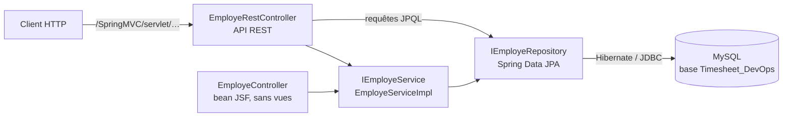

# Timeseet_DevOps — Timesheet DevOps, première itération (module Employé)

**Français** · [English](README.en.md)

Première itération du projet d'équipe « Timesheet DevOps » (ESPRIT, 2021) : une application Spring Boot
limitée au module Employé, avec des tests JUnit et une intégration continue GitHub Actions.

> La version complète du projet (modules Contrat et Mission, pipeline Jenkins, image Docker) se trouve dans
> [Timesheet_DevOps](https://github.com/rachedchakchouk/Timesheet_DevOps). Les différences entre les deux
> dépôts sont détaillées plus bas, dans [Lien avec Timesheet_DevOps](#lien-avec-timesheet_devops).

## Aperçu

- Modèle JPA d'une application de feuilles de temps : entreprises, départements, employés, contrats,
  missions (internes et externes), feuilles de temps et utilisateurs.
- Service Employé (`IEmployeService` / `EmployeServiceImpl`) : création, liste, comptage, suppression et
  recherche par e-mail et mot de passe.
- API REST de sept routes (`EmployeRestController`).
- Bean JSF de connexion et de gestion des employés (`EmployeController`) ; le dépôt ne contient aucune vue JSF.
- Tests : démarrage du contexte Spring (JUnit 5) et tests du service Employé (JUnit 4).

## Stack technique

Versions lues dans `pom.xml`, `.mvn/wrapper/maven-wrapper.properties` et `.github/workflows/ci.yml`.

| Couche | Technologie | Version |
|---|---|---|
| Langage | Java | 8 (`java.version` = 1.8) |
| Framework | Spring Boot (Web, Data JPA) | 2.7.18 |
| Framework | Spring Framework | 5.3.39 (fixée dans le pom) |
| Serveur embarqué | Apache Tomcat | 9.0.123 (fixée dans le pom) |
| Persistance | Hibernate ORM | gérée par Spring Boot (5.6.15.Final d'après le journal CI) |
| Base de données | MySQL, pilote `com.mysql:mysql-connector-j` | pilote 8.4.0 ; MySQL 8.4 en CI |
| JSF (sans vues) | Apache MyFaces (`myfaces-api`, `myfaces-impl`), OCPsoft Rewrite, `tomcat-embed-jasper` | 2.2.15 ; 3.5.2.Final ; gérée par Spring Boot |
| Outillage | Lombok (déclaré, non utilisé dans le code) | gérée par Spring Boot |
| Journalisation | Logback (Spring Boot) ; API Log4j 2 dans les tests | Log4j 2.25.5 (`log4j2.version`) |
| Tests | JUnit 5 (`spring-boot-starter-test`), JUnit 4 et moteur `junit-vintage-engine`, AssertJ | gérées par Spring Boot |
| Build | Maven, via le Maven Wrapper | Maven 3.8.2 |
| CI | GitHub Actions, JDK Temurin, service MySQL | JDK 8, image `mysql:8.4` |

## Architecture

Architecture en couches : `entity` → `repository` (Spring Data JPA) → `service` → contrôleurs. Le contrôleur
REST appelle le service et, pour les requêtes JPQL, directement le dépôt.



Le bean `EmployeController` (portée session) gère la connexion, réservée au rôle `ADMINISTRATEUR`, et
l'ajout, la modification et la suppression d'employés. Il renvoie vers `/login.xhtml` et
`/pages/admin/welcome.xhtml`, mais ces vues ne figurent pas dans le dépôt et aucun `FacesServlet` n'est
déclaré : seule l'API REST est utilisable.

## Structure du dépôt

```text
Timeseet_DevOps/
├── .github/
│   ├── dependabot.yml              # mises à jour Maven et GitHub Actions
│   └── workflows/ci.yml            # CI : compilation et tests avec MySQL
├── .mvn/wrapper/                   # Maven Wrapper (Maven 3.8.2)
├── mvnw, mvnw.cmd                  # lanceurs du wrapper (Linux/macOS, Windows)
├── pom.xml
└── src/
    ├── main/java/tn/esprit/spring/
    │   ├── TimesheetDevOpsApplication.java
    │   ├── control/                # EmployeController (bean JSF)
    │   ├── entity/                 # entités JPA et énumération Role
    │   ├── repository/             # IEmployeRepository (requêtes JPQL)
    │   ├── rest/control/           # EmployeRestController (API REST)
    │   └── service/                # IEmployeService, EmployeServiceImpl
    ├── main/resources/application.properties
    └── test/java/tn/esprit/spring/
        ├── TimesheetDevOpsApplicationTests.java    # démarrage du contexte (JUnit 5)
        └── test/EmployeServiceImplTest.java        # tests du service Employé (JUnit 4)
```

## Prérequis

- JDK 8 (la CI utilise Temurin 8). Sous Windows, `JAVA_HOME` doit pointer vers ce JDK : `mvnw.cmd` s'arrête
  sinon.
- MySQL 8 sur `localhost:3306`, avec le compte `root` sans mot de passe (configuration du dépôt), ou Docker
  pour lancer le même MySQL que la CI.
- Git. Maven n'est pas nécessaire : le wrapper télécharge Maven 3.8.2 (accès à Maven Central requis).

## Installation et lancement en local

Windows (PowerShell) :

```powershell
git clone https://github.com/rachedchakchouk/Timeseet_DevOps.git
cd Timeseet_DevOps

# Facultatif : MySQL 8.4 comme en CI (root sans mot de passe) ; attendez qu'il soit prêt
docker run -d --name mysql-timesheet -p 3306:3306 -e MYSQL_ALLOW_EMPTY_PASSWORD=yes mysql:8.4

.\mvnw.cmd spring-boot:run
```

Linux / macOS (`mvnw` n'est pas marqué exécutable dans le dépôt : lancez-le avec `sh` ou faites `chmod +x mvnw`) :

```bash
git clone https://github.com/rachedchakchouk/Timeseet_DevOps.git
cd Timeseet_DevOps
docker run -d --name mysql-timesheet -p 3306:3306 -e MYSQL_ALLOW_EMPTY_PASSWORD=yes mysql:8.4   # facultatif
sh mvnw spring-boot:run
```

L'application écoute sur le port **9090** ; toutes les routes sont préfixées par `/SpringMVC/servlet`, par
exemple <http://localhost:9090/SpringMVC/servlet/count-employe>.

Pour produire et lancer le JAR exécutable :

```powershell
.\mvnw.cmd -B package -DskipTests
java -jar target\Timesheet_DevOps-1.0.jar
```

```bash
sh mvnw -B package -DskipTests
java -jar target/Timesheet_DevOps-1.0.jar
```

## Configuration

Toute la configuration se trouve dans `src/main/resources/application.properties` ; aucun profil Spring n'est
défini.

| Clé | Valeur dans le dépôt | Rôle |
|---|---|---|
| `server.port` | `9090` | port HTTP |
| `server.servlet.context-path` | `/SpringMVC` | chemin de l'application |
| `spring.mvc.servlet.path` | `/servlet` | chemin du `DispatcherServlet` |
| `spring.datasource.url` | `jdbc:mysql://localhost:3306/Timesheet_DevOps?createDatabaseIfNotExist=true&…` | base MySQL, créée si elle n'existe pas |
| `spring.datasource.username` | `root` | compte MySQL |
| `spring.datasource.password` | vide | mot de passe MySQL |
| `spring.jpa.hibernate.ddl-auto` | `update` | schéma créé ou mis à jour au démarrage |
| `spring.jpa.show-sql` | `true` | requêtes SQL affichées dans la console |
| `spring.jpa.properties.hibernate.dialect` | `org.hibernate.dialect.MySQL5Dialect` | dialecte SQL |
| `logging.file.name` | `D:/LOG` | fichier de journal (chemin Windows) |
| `logging.logback.rollingpolicy.max-file-size` | `100KB` | taille maximale d'un fichier de journal |
| `logging.level.root` | `INFO` | niveau de journalisation |

Toute clé peut être remplacée par une variable d'environnement (convention Spring Boot) sans modifier le
fichier, par exemple pour un compte MySQL protégé ou un autre chemin de journal :

```powershell
$env:SPRING_DATASOURCE_USERNAME = "<utilisateur>"
$env:SPRING_DATASOURCE_PASSWORD = "<mot de passe>"
$env:LOGGING_FILE_NAME = "logs/timesheet.log"
.\mvnw.cmd spring-boot:run
```

```bash
export SPRING_DATASOURCE_USERNAME='<utilisateur>'
export SPRING_DATASOURCE_PASSWORD='<mot de passe>'
export LOGGING_FILE_NAME=logs/timesheet.log
sh mvnw spring-boot:run
```

Sous Linux et macOS, `D:/LOG` est un chemin relatif : sans surcharge, le journal est écrit dans `D:/LOG` sous
le répertoire de lancement.

## Base de données

- Moteur : MySQL. La base `Timesheet_DevOps` est créée au premier démarrage (`createDatabaseIfNotExist=true`).
- Schéma : généré par Hibernate (`ddl-auto=update`) ; aucun outil de migration (Flyway, Liquibase).
- Tables créées (journal de la CI) : `t_contrat`, `t_departement`, `t_departement_employe` (jointure),
  `t_employe`, `t_entreprise`, `t_mission`, `t_timesheet`, `t_user`.
- Le dialecte `MySQL5Dialect` crée des tables MyISAM : MySQL n'y applique pas les clés étrangères déclarées
  et n'y gère pas les transactions.
- Aucune donnée de démonstration n'est fournie.

Relations entre entités (annotations JPA) :

| Relation | Mise en œuvre |
|---|---|
| `Entreprise` 1 — n `Departement` | colonne `entreprise_id` dans `t_departement` |
| `Departement` n — n `Employe` | table `t_departement_employe` |
| `Departement` 1 — n `Mission` | colonne `departement_id` dans `t_mission` |
| `Employe` 1 — 1 `Contrat` | colonne `contrat_reference` dans `t_employe` |
| `Employe` 1 — n `Timesheet`, `Mission` 1 — n `Timesheet` | colonnes `employe_id` et `mission_id` dans `t_timesheet` |
| `MissionExterne` hérite de `Mission` | table unique `t_mission`, colonne `dtype` |
| `User` | table indépendante `t_user` (rôle stocké par son rang) |

L'énumération `Role` vaut `CHEF_DEPARTEMENT`, `INGENIEUR`, `TECHNICIEN`, `STUDENT` ou `ADMINISTRATEUR`.

## API

URL de base : `http://localhost:9090/SpringMVC/servlet`. Aucune route n'est protégée.

| Méthode | Chemin | Entrée | Réponse |
|---|---|---|---|
| POST | `/ajouter-employe` | corps JSON `Employe` | identifiant de l'employé créé |
| GET | `/count-employe` | — | nombre d'employés (`count()` de Spring Data) |
| GET | `/count-employe-jpql` | — | nombre d'employés (requête JPQL) |
| GET | `/get-employeprenom-by-id/{idemploye}` | identifiant | champ `nomEmploye` de l'employé |
| GET | `/get-all-nameemploye` | — | liste des noms (`nomEmploye`) |
| GET | `/get-all-employe-by-entreprise` | corps JSON `Entreprise` (requête GET avec corps) | employés des départements de l'entreprise |
| GET | `/get-employe-by-email-password/{email}/{password}` | e-mail et mot de passe dans l'URL | employé correspondant |

Exemple (les clés JSON suivent les accesseurs de l'entité `Employe`) :

```bash
curl http://localhost:9090/SpringMVC/servlet/count-employe
curl -X POST http://localhost:9090/SpringMVC/servlet/ajouter-employe \
  -H "Content-Type: application/json" \
  -d '{"nomEmploye":"Test","prenomEmploye":"Exemple","emailEmploye":"exemple@example.com","actif":true,"roleEmploye":"INGENIEUR","password":"changeme"}'
```

```powershell
Invoke-RestMethod http://localhost:9090/SpringMVC/servlet/count-employe
Invoke-RestMethod -Method Post -Uri http://localhost:9090/SpringMVC/servlet/ajouter-employe -ContentType "application/json" -Body '{"nomEmploye":"Test","prenomEmploye":"Exemple","emailEmploye":"exemple@example.com","actif":true,"roleEmploye":"INGENIEUR","password":"changeme"}'
```

## Tests

| Classe | Nature | Besoins |
|---|---|---|
| `TimesheetDevOpsApplicationTests` | JUnit 5 : démarrage du contexte Spring | un MySQL accessible |
| `EmployeServiceImplTest` | JUnit 4 (`@RunWith(SpringRunner.class)`), exécuté par le moteur vintage : ajout, liste non vide, comptage, recherche d'un employé par e-mail et mot de passe, suppression de l'employé n° 6 ; délais maximums sur l'ajout et la suppression | une base déjà remplie (employé précis, identifiant 6) |

Tests tels que les lance la CI (sans `EmployeServiceImplTest`) :

```powershell
.\mvnw.cmd -B verify "-Dtest=!EmployeServiceImplTest" "-Dsurefire.failIfNoSpecifiedTests=false"
```

```bash
sh mvnw -B verify -Dtest='!EmployeServiceImplTest' -Dsurefire.failIfNoSpecifiedTests=false
```

Tous les tests, sur une base qui contient les données attendues : `.\mvnw.cmd test` ou `sh mvnw test`.

## Build, CI et déploiement

Le workflow `.github/workflows/ci.yml` (« CI ») :

- se déclenche à chaque push sur `master` ou `main` et à chaque pull request (y compris celles de Dependabot) ;
  un nouveau run annule le précédent sur la même référence ;
- job « Back (Maven) » sur `ubuntu-latest` (25 minutes au plus), avec un service `mysql:8.4` (compte `root`
  sans mot de passe, port 3306) et le JDK Temurin 8 (cache Maven) ;
- lance `mvn -B verify -Dtest='!EmployeServiceImplTest' -Dsurefire.failIfNoSpecifiedTests=false` :
  compilation, test de démarrage du contexte, puis JAR exécutable ; `EmployeServiceImplTest` est exclu car il
  suppose une base déjà remplie, alors que la base de la CI est vide ;
- en cas d'échec, l'étape « Résumé des erreurs » remonte les erreurs Maven et les tests en échec sous forme
  d'annotations ;
- ne publie aucun artefact.

`.github/dependabot.yml` propose chaque lundi à 06:00 (heure de Tunis) des mises à jour groupées des
dépendances Maven et des actions GitHub ; les montées de version majeure de Spring Boot sont exclues.

Le dépôt ne contient ni Dockerfile ni Jenkinsfile (ils sont dans `Timesheet_DevOps`).

## Sécurité

- Pas de Spring Security : toutes les routes sont publiques ; aucune règle CORS n'est définie.
- Les mots de passe des employés sont stockés en clair (colonne `PASSWORD`) et figurent dans le JSON des
  employés renvoyé par l'API ; la route `/get-employe-by-email-password/{email}/{password}` transmet le mot de
  passe dans l'URL.
- Aucun secret n'est versionné : en local comme en CI, MySQL est utilisé avec le compte `root` sans mot de
  passe. Pour un autre compte, fournissez les identifiants par variables d'environnement (voir
  [Configuration](#configuration)).

## Lien avec Timesheet_DevOps

Les deux dépôts relèvent du même projet d'équipe, mais ils n'ont aucun commit en commun.

| | Timeseet_DevOps (ce dépôt) | [Timesheet_DevOps](https://github.com/rachedchakchouk/Timesheet_DevOps) |
|---|---|---|
| Nature | dépôt indépendant, créé le 10 octobre 2021 | fork de `TarekMESSAOUDI/Timesheet_DevOps` |
| Code d'origine | trois commits du 9 octobre 2021 | historique d'équipe d'octobre à novembre 2021 |
| Version Maven | `1.0` | `2.0` |
| Code métier | module Employé : un dépôt, un service, un contrôleur REST, un bean JSF | modules Employé, Contrat et Mission exposés en REST ; services Département et Projet |
| Entités | `Contrat`, `Departement`, `Employe`, `Entreprise`, `Mission`, `MissionExterne`, `Timesheet`, `User` | les mêmes sans `User`, avec `Projet` |
| Tests | démarrage du contexte et `EmployeServiceImplTest` | aucun sur `master` (retirés le 6 novembre 2021) |
| Chaîne DevOps | GitHub Actions (ajouté en 2026) | Jenkinsfile (SonarQube, Nexus, Docker Hub), Dockerfile, JaCoCo, GitHub Actions |

Le dépôt conserve aussi les branches de travail des membres de l'équipe (`Amine-Branch`, `Ghassen-Branch`,
`Meissa-Branch`, `Moneim-Branch`, `Rached-Branch`, `Tarek-Branch`) ; seules `Amine-Branch` (module Mission) et
`Meissa-Branch` (autre squelette de projet, sans historique commun) contiennent du travail absent de `master`.
Cette documentation décrit `master`.

## Auteur

Projet d'équipe DevOps réalisé à ESPRIT en 2021. Les commits d'origine (9 octobre 2021) sont signés Tarek
Messaoudi.

Dépôt maintenu par **Rached Chakchouk** — ingénieur logiciel Full Stack (Java / Spring Boot / Angular) ·
[LinkedIn](https://www.linkedin.com/in/rached-chakchouk) · [Portfolio](https://rached-chakchouk.netlify.app)
